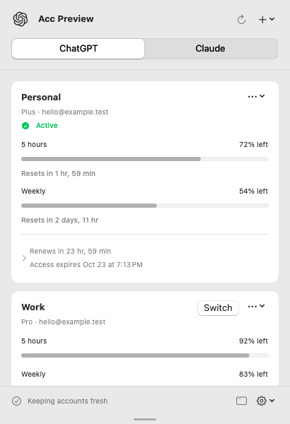

# Acc

**Your Codex and Claude accounts, ready when you need them.**

Acc lives in your Mac's menu bar. It keeps authentication fresh in the background,
shows your remaining usage, and makes switching between personal and work
accounts a click away.

**[Download for macOS](https://github.com/morajabi/acc/releases/latest/download/Acc-macOS.zip)** · [Releases](https://github.com/morajabi/acc/releases) · [Contributing](CONTRIBUTING.md)

  
  

Screenshots use example accounts.

## Less account juggling

- **Stay signed in.** Automatic renewal, launch at login, and clear expiry and renewal status.
- **See what's left.** Five-hour and weekly usage, with reset times when available.
- **Switch in a click.** Keep multiple accounts for ChatGPT/Codex and Claude Code.
- **Add accounts your way.** Browser sign-in, save the current login, or import a file.
- **Keep control.** Renew, rename, replace, pause, or remove an account. Use the menu bar or a regular window.

Switching updates the provider's local login. Restart an already-open provider
client to pick up the selected account. Claude desktop and web logins are separate
from Claude Code.

## Get started

Download, unzip, and move **Acc.app** to **Applications**. Requires **macOS 14+**;
the same download works on Apple silicon and Intel.

The release notes identify its signing status. Unnotarized releases may require
**System Settings → Privacy & Security → Open Anyway** after the first launch attempt.

Open Acc, save the detected login, or choose **+ → Sign In with Browser…**.
Browser sign-in uses the installed [Codex](https://github.com/openai/codex) or
[Claude Code](https://code.claude.com/docs/en/overview) CLI in an isolated directory.
Enable login access when macOS asks so Acc can keep working in the background.

## Local and open

No telemetry. Credentials stay on your Mac in a private, **unencrypted** account
store. Acc must be running to renew them; provider revocation and lost renewal
responses can still require signing in again. [Security](SECURITY.md) · [Authentication and recovery](docs/AUTHENTICATION.md)

Built with Swift, SwiftUI, and AppKit, with an independent core and a
[CLI](docs/CLI.md). [Build and contribute](CONTRIBUTING.md) · [Verification](docs/VERIFICATION.md)

[MIT](LICENSE). Inspired by [CodexBar](https://github.com/steipete/CodexBar) and
Codex Auth Guard. Provider integration details and marks are credited in
[third-party notices](docs/THIRD_PARTY_NOTICES.md).
Acc is independent of OpenAI and Anthropic.
